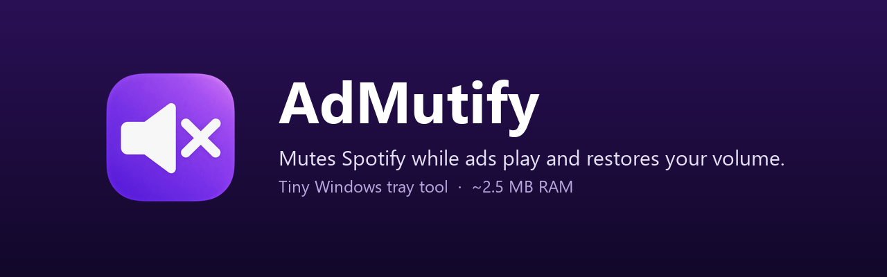

<p align="center">
  
</p>

<h1 align="center">AdMutify</h1>

<p align="center">
  
  
  
</p>

AdMutify is a tiny Windows tray tool that mutes the Spotify desktop app while an ad is playing and restores your previous volume as soon as the music is back. It only touches Spotify's own slider in the Windows volume mixer, so everything else on your PC keeps playing as before.

## Features

- Detects ads in the Spotify desktop app (regular installer and Microsoft Store version), including Spotify's own promotions for its premium plan.
- Mutes Spotify during ads, or only lowers it to a percentage you choose.
- Optionally plays your own music during ads: one file, or a folder shuffled or in name order. When the ad ends the music fades out and continues at the same spot during the next ad.
- Optionally lowers, mutes or pauses Spotify while a browser or video player plays sound for a few seconds. The lowered level is its own setting. Off by default; short sounds, games and calls are ignored.
- Restores the exact previous volume afterwards, even if AdMutify was closed or crashed in the middle of an ad.
- If you change Spotify's volume yourself during an ad, AdMutify leaves it alone.
- Tray menu with status line (for example "Ad: muted"), on/off switch and settings.
- Start with Windows, optionally without a tray icon. Open AdMutify again to bring the icon back. The setting stays in sync with the startup apps switch in Task Manager.
- Finds Spotify even when it starts minimized to the tray.
- Ten languages, light and dark mode, Windows 11 style with rounded corners.
- Old log files and crash reports are removed automatically after 7 days.
- Lightweight: a single small executable, about 2.5 MB of memory, no background polling unless the video option is on.

## Download

Get the latest version from the [Releases](../../releases) page:

- `AdMutify-Setup-<version>.exe`: installer, for the current user or for all users. Running a newer setup updates an existing installation in place. The installer can also do a portable installation.
- `AdMutify.exe`: portable version, a single file. Put it anywhere and run it. Settings are stored next to the program.

Windows 10 22H2 or Windows 11, x64. The executable is not code signed yet, so Windows SmartScreen may show a warning on first start. Each release lists the SHA-256 checksums of its files in `SHA256SUMS.txt`.

Silent installation and other setup switches are described in [installer/README.md](installer/README.md).

## How it works

Spotify shows the current song as its window title ("Artist - Song"). During an ad the title changes to "Advertisement", "Spotify" or the advertiser's name. AdMutify listens for these title changes through a Windows event hook instead of checking every few seconds, and it also checks whether Spotify is actually playing sound so a paused player is not mistaken for an ad.

When an ad starts, AdMutify mutes (or lowers) Spotify's audio session in the Windows volume mixer. When the ad is over, it puts the old value back.

AdMutify does not modify Spotify in any way: no patching, no code injection, no network or hosts file blocking. The ad still plays and is counted by Spotify, you just don't hear it.

## Settings

| Setting | What it does |
|---|---|
| Start with Windows | Adds AdMutify to your Windows startup apps. |
| No tray icon when starting with Windows | AdMutify runs invisibly after the Windows start. Open it again to show the icon. Starting it yourself always shows the icon. |
| During ads | Mute Spotify, or lower it to 0 to 90 percent of its current volume. |
| Music during ads | Off, one file, a folder shuffled or a folder in order (subfolders included; MP3, M4A, AAC, WMA, WAV, FLAC, MP2, WEBM, plus OGG, OGA, OPUS and MKA with the Web Media Extensions that come with Windows). Choose the file or folder with "Choose"; "Volume" sets how loud it plays (0 to 100 percent). Off by default. |
| During videos in other apps | Do nothing, lower Spotify, mute Spotify or pause Spotify while a browser or video player plays sound for a few seconds. Off by default. Lowering uses its own "Lower to" level (0 to 90 percent). Pausing continues playback when the video ends. |
| Language | System (follows Windows), or one of English, Deutsch, Español, Português (Brasil), Italiano, Nederlands, Polski, Türkçe, 日本語 and 简体中文. The installer speaks the same languages. |

Settings are stored in `%APPDATA%\AdMutify` (portable: next to the exe), logs in `%LOCALAPPDATA%\AdMutify\logs` (portable: in `logs` next to the exe). Uninstalling asks whether these should be deleted too.

## Privacy

AdMutify makes no network connections at all and sends nothing anywhere. It only keeps a small log file and, after a crash, a crash report on your own PC; both are deleted automatically after 7 days. The log only records state changes such as "music" or "ad", never song titles. Titles are only written when you start AdMutify yourself with the `--trace` switch for troubleshooting. A crash report can contain file paths of your PC, such as your user folder, so look at it before you share it.

## Build from source

Requirements: Visual Studio 2022 or newer with the C++ desktop workload, CMake 3.21+, and [Inno Setup 6](https://jrsoftware.org/isinfo.php) for the installer.

```bat
build.bat
```

`build.bat` builds the release executable, runs the tests, and writes the portable `AdMutify.exe`, the installer and `SHA256SUMS.txt` to `dist\`. Set `NOSTART=1` to skip starting the fresh build and `NOPAUSE=1` to never wait for a key press.

## Disclaimer

AdMutify is an independent project and is not affiliated with, endorsed by or connected to Spotify. "Spotify" is a trademark of Spotify AB. You are responsible for using Spotify in line with its terms of use. The software is provided as is, without warranty of any kind.

## License

[MIT](LICENSE). © 2026 BGCoding
